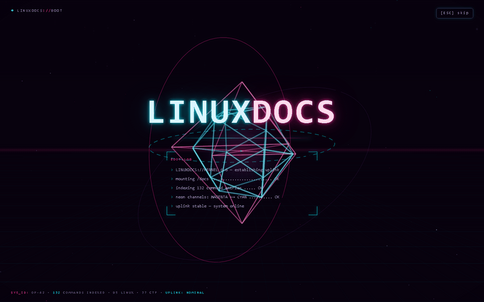
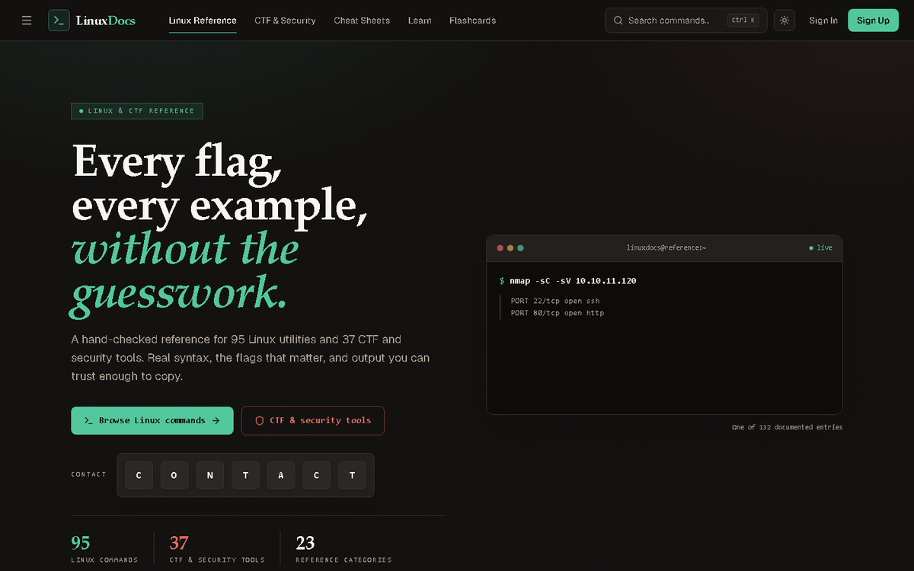
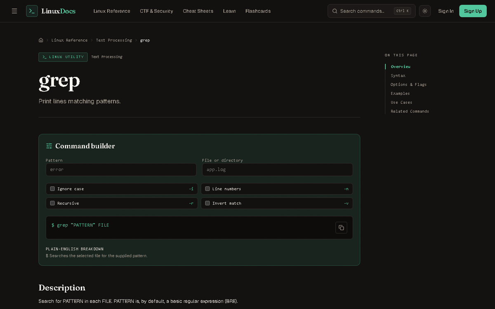
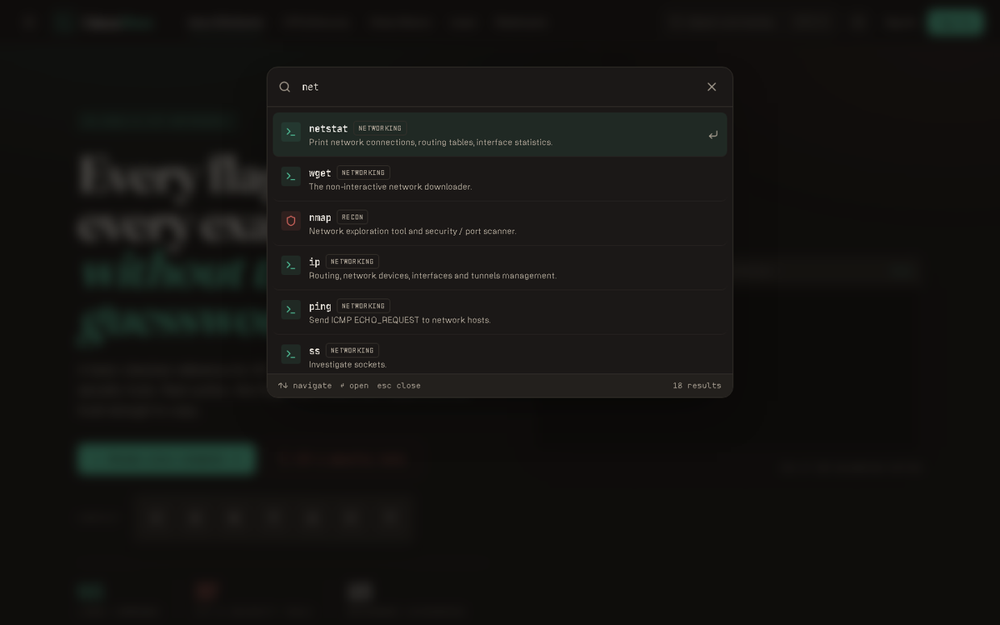
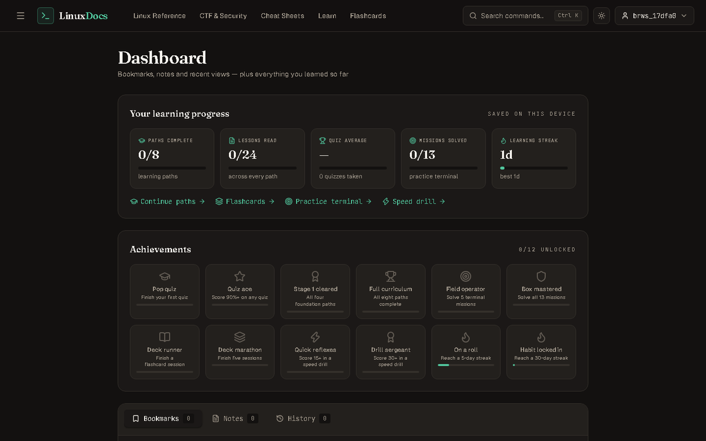
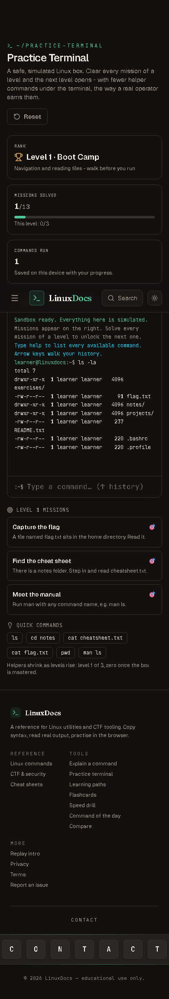
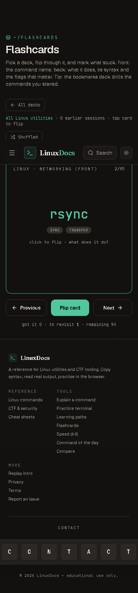
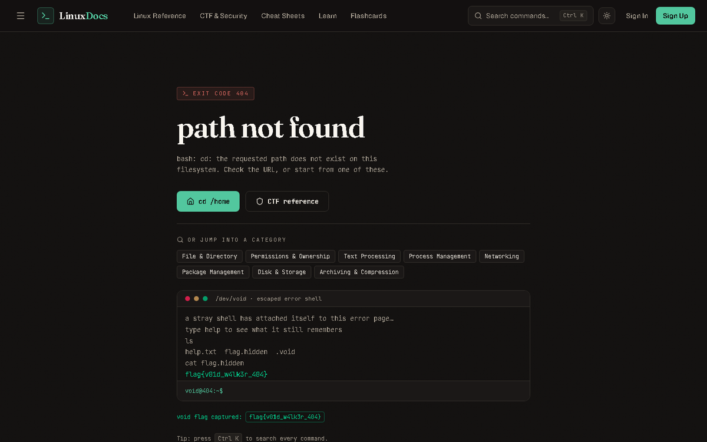

<div align="center">


# LinuxDocs

**Every flag, every example, without the guesswork.**

A hand-checked MDN-style reference for **95 Linux utilities + 37 CTF & security tools**, wrapped in a full learning platform — guided paths, a mission-based practice terminal, quizzes, flashcards, and a speed drill — with real accounts that persist progress.

[](https://react.dev)
[](https://www.typescriptlang.org)
[](https://flask.palletsprojects.com)
[](#deploy-your-own)
[](#how-it-is-verified)

▶ **Live app:** *[https://linuxdocs-frontend.vercel.app](https://linuxdocs-frontend.vercel.app)* — **Demo GIF below** 👇

</div>

---

## The demo (8 real pages, captured during automated QA)



*Intro boot sequence → landing → a full command page → the Ctrl+K command palette → the practice sandbox → flashcards → the signed-in dashboard → the 404 page that hides a flag.*

## Why I built it

When I started learning Linux and CTF tooling, the information was everywhere and nowhere: `man` pages are complete but unreadable for beginners, blog posts contradict each other, and cheat sheets show flags without explaining what they change. I kept wishing for an MDN for the terminal — one index where every command had the same honest structure: syntax, the flags that actually matter, copy-paste examples **with the output you should expect**, and what to reach for next.

So LinuxDocs is:

- **The reference I wanted** — 132 hand-checked entries (95 Linux utilities, 37 CTF tools) in a consistent MDN-style layout, each with a *Command Builder* that assembles the real flag string as you toggle options, plus "Spotted a mistake? Report it." because accuracy is the product.
- **The practice I needed** — 8 guided learning paths with 24 lessons and quizzes; a safe, simulated practice terminal where 13 missions across 3 ranks ("Boot Camp" → "Operator") must be solved to unlock more helper hints — like a real operator earning their way; flip-style flashcards over all 95 Linux utilities; a speed drill; achievements; daily streaks.
- **The engineering exercise of doing auth right** — silent-refresh JWT sessions, and every deployment decision justified below.

## What's inside

| Area | Details |
|---|---|
| 📚 **Reference** | 95 Linux + 37 CTF tools — syntax, flag tables with per-flag examples, worked examples with sample output, related commands, tags; Ctrl+K command palette (keyboard-first, reachable from every page) |
| 🎓 **Learn** | 8 paths × 24 lessons (Linux foundations → permissions → processes → systemd; CTF recon → web → crypto → forensics), quiz builder with difficulty + question-count controls |
| 🖥️ **Practice terminal** | Simulated filesystem (`ls`, `cat`, `man`, `grep`, pipes…) + 13 missions over 3 ranks; helpers are retired as you rank up; ↑ history, Ctrl+L clear |
| 🔁 **Flashcards** | Flip-style spaced repetition over every Linux utility with "Again / Got it" marking |
| ⚡ **Speed drill** | Timed command-identification drill with per-session scoring |
| 🏆 **Progress** | Achievements, streaks, per-path progress, all synced to your account when signed in |
| 🔐 **Accounts** | Register / sign in / silent refresh / sign out; bookmarks, per-command notes (Ctrl+S autosave), history — synced across devices. **Sign-in first:** every page except the auth pages, legal pages and 404 sits behind `ProtectedRoute`; a signed-out deep link bounces to `/sign-in?next=<where>` and login returns you exactly there |

<div align="center">
  
  
</div>

## Screenshots

| | |
|---|---|
|  |  |
| *Ctrl+K palette — filters 132 entries by name, category, and tags* | *Dashboard — progress across paths, quizzes, missions + achievements* |

<p align="center">
  
  &nbsp;&nbsp;&nbsp;
  
</p>
<p align="center"><sub>The practice sandbox and flashcards are fully phone-sized friendly (390×844).</sub></p>

Mistyped a URL? The 404 page is itself a terminal — type `cat flag.hidden` and you'll find it hides a flag for curious learners: 

## How it is verified

The repo ships its own test harnesses (in `qa/`, untracked). One command runs
the whole gate — production build, lint, the backend pytest suite, the dataset
docs-accuracy audit, then every live browser/API probe in order — and prints a
pass/fail table (full per-suite output is kept under `qa/last-qarun/`). It
starts the dev servers itself if they are not already running and never waits
on a missing environment:

```powershell
npm run qa                                   # the one-shot full gate
```

Individual suites:

```powershell
# 217 pytest backend tests (catalog, auth, DB config, migrations/RLS, health, mailer, user-data, dataset suites)
cd backend; .\venv\Scripts\pytest           # 217 passed

# 19-step API smoke test (stdlib only): register → login → catalog under JWT →
# refresh → logout → revoked-after-logout → unauth 401 gates on every
# dataset endpoint → 401/404 shape checks
python qa/smoke_api.py                      # 19/19 PASS

# Dataset docs-accuracy audit (stdlib only): re-validates all 132 entries —
# slug/category integrity, flag & example rules, destructive/root warning
# coverage, indexing against backend/data — see qa/dataset_audit.py
python qa/dataset_audit.py                  # AUDIT PASSED

# Real-browser QA (Chrome DevTools Protocol, headless): drives the auth-gated
# world — logged-out deep links bounce to /sign-in?next=..., sign-up redirect,
# session surviving a hard reload, 8 random command pages, docs-pending chip
# on thin vs. complete entries, Ctrl+K palette, sign-in honoring ?next and
# returning to the command page, logout + browser-back showing no command
# content, the void-terminal 404 flag, then a 390×844 phone viewport running
# the practice terminal, a full quiz, and flashcards — while logging every
# console message per page.
python qa/browser_check.py                  # 34/34 PASS

# Dataset-leak scan of the production bundle: pulls 5 distinctive sentences
# from backend/data and greps every dist/ artifact for them (run after build)
python qa/dist_probe.py                     # DIST CLEAN
```

`qa/browser_check.py` types with real CDP input events (not synthetic ones), captures Network responses for the auth calls, and reports console errors per page — that last check is how a "signed-out visitor gets a 401 console line on every page" bug was found in the auth boot flow and fixed with a session-hint in `AuthContext`.

## Architecture

```
Browser ──(one origin)──► Vercel  ──/api/* proxy──► Render (Flask API) ──► Supabase Postgres
                          │                              ▲
                          └── static React SPA (Vite)     └── host-allowlist + rate limits + CORS
```

- **Frontend** — Vite + React 19 + TypeScript + Tailwind CSS v4. Route-level code splitting (the intro's 3D scene loads only on `/intro` or first visit). Route changes animate through Animate UI's view-transition **page transition (the `bands` effect)** while the shell stays put. All state flows through typed services (`src/services/api.ts`).
- **Dataset API** — the documentation corpus lives only in `backend/data` (132 per-slug JSON files + a generated aggregate/index) and is served through two JWT-protected endpoints: `GET /api/catalog/index` (categories, domains, counts, plus a light index with only `name/summary/tags/slug/category`) and `GET /api/commands/<slug>` (the full doc), both ETag/304-stamped with `Cache-Control: private`. The SPA fetches the light index once after login and every command doc on demand into an in-memory cache cleared on logout/account switch — the shipped bundle carries zero command prose.
- **Auth model** — JWT access token lives **in memory only** (15 min); the refresh credential is an **HttpOnly, SameSite=Strict cookie** (30 days) backed by opaque rotating session tokens with reuse (theft) detection. A single-flight refresh promise stops a tab full of failing requests from stampeding the auth endpoint.
- **The same-origin trick** — `vercel.json` proxies `/api/*` to the Render API, so the browser only ever talks to one domain. That makes the refresh cookie first-party on the frontend origin — no `SameSite=None`, no third-party-cookie breakage, no CORS drama. In dev, `vite.config.ts` does the identical thing to `localhost:5000`.
- **Backend** — Flask 3 + SQLAlchemy + Bcrypt + JWT-Extended. Env-driven config; request logging; per-endpoint **and** global rate limits; account lockout with attempt windows; CSRF origin checks; **Host-header allowlist**; payload clamps; hardened security headers (CSP/HSTS) in production. The `DATABASE_URL` is normalized at boot (legacy schemes rewritten, TLS pinned for remote hosts, session/transaction pool mode auto-detected with a bounded connect-retry for cold-started databases), and **`/api/ready`** answers a live `SELECT 1` with latency + mode — when the database is unreachable, every data view fails as a clean `503 {error, request_id}` instead of a raw 500.
- **Data durability** — SQLite runs WAL + `synchronous=FULL` + automatic verified backups with self-healing restore on corruption. Point `DATABASE_URL` at Supabase Postgres and the SQLite-only machinery disables itself cleanly — no forks, no code changes. Schema lives behind Flask-Migrate/Alembic (`migrations/versions/`), so `flask db upgrade` is the only schema step on any backend, and `003_rls_lockdown` enables Row Level Security with zero permissive policies on every table (the Supabase Data API is additionally disabled — see the deploy doc).

## Quick start (local)

Prerequisites: Node 20+, Python 3.11+.

```powershell
git clone <your-repo-url>
cd LinuxDocs
npm install

cd backend
python -m venv venv
.\venv\Scripts\pip install -r requirements.txt
copy .env.example .env      # then fill in the two secrets (see below)
cd ..

npm run dev:all             # Vite on :5173 (proxies /api) + Flask on :5000
```

Frontend: http://localhost:5173 — API: http://localhost:5000/api

Required `.env` variables (in `backend/.env` — never commit it):

| Variable | Value |
|---|---|
| `SECRET_KEY` | `python -c "import secrets; print(secrets.token_hex(32))"` |
| `JWT_SECRET_KEY` | same generator, different value |
| `DATABASE_URL` | `sqlite:///instance/app.db` (local default) |
| `FRONTEND_ORIGIN` | `http://localhost:5173` |

## Deploy your own

> Full click-by-click version: **[docs/DEPLOY_SUPABASE.md](docs/DEPLOY_SUPABASE.md)** (Supabase project → Render blueprint → Vercel import, plus the keepalive and troubleshooting checklists).

**1. Database — Supabase** — Create a project, then copy **Project Settings → Database → Connection string → Session pooler** (port 5432 on the `.pooler.supabase.com` host). It is only ever pasted into Render's `DATABASE_URL` — never committed. Turn the **Data API off** (Settings → API): the app never uses the anon/service-role keys, and migration `003_rls_lockdown` enables Row Level Security with zero permissive policies on every table as a second layer.

**2. Create the backend on Render** — **New + → Blueprint** and pick the repository. `render.yaml` provisions the `linuxdocs-api` web service on the free plan (region singapore, Python 3.11.x, gunicorn with **1 worker + 4 threads**) and an `DATABASE_URL` slot you fill with the session-pooler URI. Every start runs the schema through alembic first, so it is **idempotent**: `flask db upgrade && gunicorn "app:create_app()" …`. Migrations (the Flask-Migrate chain `001_initial → 002_user_progress → 003_rls_lockdown`) run only via the **session** pooler — never the transaction pooler (:6543). Strong `SECRET_KEY`/`JWT_SECRET_KEY` regenerate automatically.

**3. Point it at your frontend** — After the first deploy, Render gives the service a URL like `https://linuxdocs-api.onrender.com`. Set its env vars:

| Variable | Set to |
|---|---|
| `FRONTEND_ORIGIN` | your Vercel site URL (`https://…vercel.app`) |
| `ALLOWED_HOSTS` | the Render service host **and** the Vercel domain (`linuxdocs-api.onrender.com,<your-site>.vercel.app` — with `TRUST_PROXY_HEADERS=1` the Host check sees X-Forwarded-Host, which is the Vercel domain for browser traffic) |

**4. Create the frontend on Vercel** — **New Project → Import repo**. Vercel auto-detects the `vercel.json`: builds with `npm run build`, serves `dist/`, and applies the two rewrites:

```jsonc
"rewrites": [
  { "source": "/api/:path*", "destination": "https://linuxdocs-api.onrender.com/api/:path*" }, // API proxy
  { "source": "/:path*",     "destination": "/index.html" }                                    // SPA fallback
]
```

Then update `FRONTEND_ORIGIN`/`ALLOWED_HOSTS` on Render with the final Vercel URL and redeploy once — accounts, refresh cookies, and rate limiting all work across the proxy exactly like they do locally.

**5. Password-reset email delivery** — Set the mail provider on the `linuxdocs-api` service (Resend is simplest, no SMTP ports involved):

| Variable | Set to |
|---|---|
| `RESEND_API_KEY` | `re_…` from the Resend dashboard (or use `SMTP_HOST`/`SMTP_PORT`/`SMTP_USER`/`SMTP_PASSWORD` for any SMTP server) |
| `MAIL_FROM` | `LinuxDocs <no-reply@yourdomain.com>` (or `onboarding@resend.dev` for testing) |

From then on, `/password-reset` emails the registered address a branded message with a **single-use, 30-minute link** — tokens are never returned by the API, never logged, and stored only as SHA-256 hashes. The request response is **byte-identical whether or not the address is registered** (no user enumeration), delivery failures answer the same generic response, a successful reset signs the user out of every session, and both reset endpoints are rate-limited (5 requests/hour/IP + 10 token attempts/hour/IP). Local development needs no provider at all: with nothing configured the mailer writes the message into a dev mailbox at `backend/instance/dev_outbox/*.eml` that you open like a real inbox.

*Why the rewrite matters:* with `/api` on the site's own origin, the HttpOnly refresh cookie is first-party `SameSite=Strict`. The whole scary class of cross-site auth issues (third-party cookie deprecation, `SameSite=None` + cross-domain CSRF) simply does not apply.

## API endpoints

All under `/api` (CORS restricted to `FRONTEND_ORIGIN`):

| Method | Endpoint | Auth | Description |
|--------|----------|------|-------------|
| GET | `/health` | — | Liveness probe, no DB touch (Render `healthCheckPath`) |
| GET | `/ready` | — | Live `SELECT 1` + `latency_ms` + connection mode; `503 {error, request_id}` when the DB is unreachable |
| POST | `/auth/register` | — | Register (rate-limited) |
| POST | `/auth/login` | — | Login → access token + HttpOnly refresh cookie |
| POST | `/auth/refresh` | Refresh cookie | New access token (single-flight on client) |
| POST | `/auth/logout` | — | Revoke session + clear cookie |
| GET | `/auth/me` | Access token | Current user |
| GET | `/catalog/index` | Access token | Light catalog: categories, domains, counts + a name/summary/tags index (ETag/304, private cache) |
| GET | `/commands/:slug` | Access token | Full doc for one command (ETag); the legacy full-doc list route was removed |
| POST | `/auth/request-password-reset` | - | Email-token reset (generic response) |
| POST | `/auth/reset-password` | — | Complete reset with token |
| GET/POST | `/user/bookmarks` (+`/toggle`) | Access token | Bookmark sync |
| GET/POST/DELETE | `/user/notes[/:slug]` | Access token | Per-command notes |
| GET/POST | `/user/history` (+`/add`) | Access token | Recently viewed |
| POST | `/user/change-password` | Access token | Change password |
| POST | `/user/data/import` | Access token | Import synced progress |
| DELETE | `/user/delete-account` | Access token | Full cascade delete |

## Project structure

```
LinuxDocs/
├── src/                      # Frontend (React 19 + TS)
│   ├── components/           #   Command pages, palette, intro scene, header…
│   ├── context/              #   Auth (silent refresh + session hint), Catalog (light index + per-slug doc cache), Theme
│   ├── data/commandBuilders.ts # interactive builder specs (UI tool; command docs live behind the API)
│   ├── pages/                #   Reference, Learn, PracticeTerminal, Flashcards, …
│   └── services/api.ts       #   Typede API client + single-flight refresh
├── backend/                  # Flask 3 API
│   ├── app/                  #   factory, models, auth, user, security, sessions, persistence, database.py
│   ├── data/                 #   132 per-slug docs + generated aggregate/index (source of truth)
│   ├── scripts/              #   build_commands.mjs (regenerate aggregate/index; fails on violations)
│   ├── migrations/           #   Alembic chain 001_initial → 002_user_progress → 003_rls_lockdown
│   ├── tests/                #   217 pytest cases (catalog, auth, DB config, migrations/RLS, health, mailer…)
│   └── requirements.txt      #   pinned (gunicorn + psycopg 3 (binary) for Render)
├── docs/                     # README assets + deploy guides (DEPLOY_SUPABASE.md, BACKEND_GUIDE.md)
├── qa/                        # browser_check.py / smoke_api.py (gitignored)
├── render.yaml                # Render blueprint: linuxdocs-api service (DATABASE_URL stays dashboard-only)
└── vercel.json                # /api/* proxy + SPA fallback
```

## License

MIT
